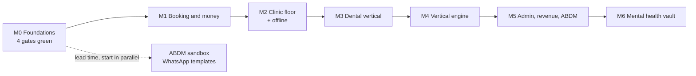

# PractixOS — Build Protocol

How PractixOS gets built, by whom, in what order, and what "done" means.

[AGENTS.md](../../AGENTS.md) is the short contract and is loaded automatically into every agent
session. This is its long form. Where they appear to disagree, AGENTS.md wins and this document is
wrong and should be corrected.

Companion documents: [Dr.App.txt](../spec/Dr.App.txt) (the specification, normative) ·
[IMPLEMENTATION-PLAN.md](IMPLEMENTATION-PLAN.md) (architecture and schema) ·
[TRACEABILITY.md](TRACEABILITY.md) (generated coverage report)

---

## 1. Bootstrap — a machine that has never seen this repository

```bash
git clone <repo> && cd doctor-app

node --version      # 22.x. The API targets Node 22 on arm64.
python3 --version   # 3.10+. Tooling only; nothing in production is Python.
docker --version    # Required. The gate tests run against a real PostgreSQL container.
google-chrome --version   # or chromium. Required by the layout gate.

./scripts/verify.sh
```

**On a clean checkout `verify.sh` fails, and that is correct.** The prototype checks pass, the
build steps report as skipped because `src/` does not exist yet, and the traceability gate goes red
listing every requirement scheduled into M0 with no test claiming it. That red list is your starting
to-do list, and it is the proper initial state for test-driven work: if the build were green before
anything had been built, green would mean nothing.

What would be wrong is a failure anywhere *other* than the traceability gate — a failing prototype
harness or layout check means you have inherited a broken baseline, and every subsequent green run
would be meaningless. Fix that first.

Then read, in this order:

1. `AGENTS.md` — the contract.
2. `docs/spec/Dr.App.txt` §6 (the design system), §7.3 (business rules), §8.1 (functional
   requirements), §8.2 (non-functional), §10 (milestones). Open `docs/spec/Dr.App.Spec.html` in a
   browser if you prefer an indexed reading copy.
3. `docs/plan/IMPLEMENTATION-PLAN.md` §1 (the six DEVIATIONs), §2 (data architecture), §5 (delivery).
4. `prototype/PractixOS.html` in a browser. Click through all four workspaces, in all six role
   modes, at phone and desktop width. This is the product — both what it looks like and how it
   behaves — and you are reproducing it in production form, not reinterpreting it. Read its
   stylesheet too; the `:root` custom properties are the design tokens you will be using.

## 2. Spec-driven development

### 2.1 The loop

```
pick an id  →  quote it  →  failing test tagged with it  →  implement  →  verify.sh  →  trace.py
```

Every change traces to an identifier that already exists in the specification. Valid forms:
`FR-1.1.2`, `BR-02`, `§4.6.1`, or a named non-functional requirement from §8.2.

### 2.2 Worked example — FR-2.2

**Step 1. Quote the requirement.** Do not paraphrase it; open the spec and read it.

> **FR-2.2** — Walk-in patient creation requires only two inputs, mobile number and patient name,
> creating the record and a queue token in under 10 seconds. *v2.2: the token is issued per
> practitioner, not once per clinic per day. A patient in a three-doctor polyclinic cares about
> their position in Dr. Rao's queue; a clinic-wide token number tells them nothing and is actively
> misleading when one practitioner runs late and another does not.*

Three testable claims: two inputs and no more, a token scoped to the practitioner, and under ten
seconds. The third is a usability requirement, so it needs a real interaction measurement, not a
unit test.

**Step 2. Write the failing tests.**

```ts
/** @spec FR-2.2 — walk-in creation takes exactly two inputs. */
test("walk-in registration requires only mobile number and name", async () => { ... });

/** @spec FR-2.2 — the token is per practitioner, not per clinic per day. */
test("two practitioners issue independent token sequences on the same day", async () => { ... });
```

**Step 3. Run them and watch them fail.** A test that has never been red has not been shown to test
anything.

**Step 4. Implement the smallest thing that passes.** No extra fields "while we're here". The
prototype's walk-in sheet is the reference for both the interaction and the appearance: same
fields, same order, same tokens, same sheet.

**Step 5. `./scripts/verify.sh`.** All green, or you are not done.

**Step 6. `python3 scripts/trace.py`** to regenerate `TRACEABILITY.md`, and commit it.

### 2.3 When the specification is silent, ambiguous or wrong

You amend the specification first. In order:

1. Edit `docs/spec/Dr.App.txt`.
2. Add a row to the **§0.1 revision log** recording what changed and why. This convention already
   exists and has 31 entries; match the surrounding style.
3. Regenerate the reading copy: `python3 docs/spec/build-spec-html.py`.
4. Commit the specification change **separately** from the code that implements it, so a reviewer
   can accept or reject the requirement independently of the implementation.
5. Now write the test, then the code.

Never edit `docs/spec/Dr.App.Spec.html` by hand. It is generated.

**Reinterpreting a requirement silently is the most damaging thing you can do in this repository**,
because it leaves no trace in the diff. Six months later nobody can tell whether the code is wrong
or the spec is.

## 3. Test-driven development

### 3.1 The taxonomy

| Kind | Runs against | Purpose |
| --- | --- | --- |
| **Gate** | Real PostgreSQL in Docker | The four guarantees of §10.1. Block merge. Written in M0. |
| **Acceptance** | Full stack | One per milestone exit criterion (§4). Fixed names. |
| **Integration** | Real PostgreSQL | Anything touching RLS, constraints, grants or transactions. |
| **Unit** | In process | Pure logic: fee rules, accrual arithmetic, attribution windows. |
| **Layout** | Headless Chrome | `prototype/check-layout.py` over the prototype, and `scripts/check-client-layout.py` over the built client. Both, always. |

### 3.2 Rules that are not negotiable

- **Tests are written before the code they protect.** §10.1 says so for the gates; apply it
  everywhere.
- **No mocked database in a gate or integration test.** "An isolation test that does not execute
  `CREATE POLICY` is testing the test" (§10.1).
- **Never weaken, skip or delete a gate to make a build pass.** A red gate is information. If a gate
  is genuinely wrong, fix the gate in its own commit with the reasoning written down.
- **Assert the property, not the implementation.** "No cross-tenant row is returned" survives a
  refactor. "Calls `withTenant` twice" does not.
- **Reproduce before fixing.** A bug gets a failing test first.

### 3.3 The four gates, built in M0

They land before any business logic exists, because each is cheaper to write against an empty schema
than to retrofit against a full one, and because their job is to fail on the commit that breaks them
rather than at a review three weeks later.

| Gate | Asserts | Fails if |
| --- | --- | --- |
| **Tenant isolation** (FR-1.1.2, §4.4.1) | Two tenants interleaved across a pool of size 1 never observe each other's rows; a request with no tenant context reads zero rows | Any cross-tenant row is returned, or an absent context reads the previous tenant's data |
| **BR-02 under concurrency** (§4.4.2) | N simultaneous booking attempts on one chair and overlapping time range produce exactly one appointment | Two appointments exist, or zero do |
| **Vault non-recoverability** (FR-5.2, §4.4.4) | Note plaintext is unrecoverable from a full database dump plus all server-held secrets, without the patient's PIN | Any plaintext or any single-factor decryption path is reachable |
| **Layout integrity** (§8.2, §6.6) | Every view, every tenant, seven widths: no horizontal overflow and no collapsed content | `prototype/check-layout.py` or `scripts/check-client-layout.py` exits non-zero |

The layout gate runs twice, over two different artifacts, and the second one is the one that
matters. `prototype/check-layout.py` reads `prototype/PractixOS.html`, which nothing in the build
modifies — so on its own it reports green for a product that does not exist yet. From the first
client screen onward, `scripts/check-client-layout.py` runs the same assertions against the built
client, and it is a skip only while `web/` is absent.

The isolation gate must set pool `max: 1`. That is the only configuration that reproduces the R12
connection-pool leak, which otherwise passes every test you would think to write.

## 4. Milestones



**Do not begin M(n+1) until M(n)'s acceptance test passes.** Milestones are ordered by revenue
impact rather than specification order: deposits stop cash leaking from day one, while the
odontogram, valuable as it is, does not move money.

### 4.1 Scope map

Machine-readable. `scripts/trace.py` parses this block; keep the format exact. `current` is the
milestone in progress. Every milestone up to and including it must stay covered — a finished
milestone that loses coverage is a regression, and an id added to a finished milestone still has to
be claimed by a test rather than grandfathered in.

```milestone-map
current: M6
M0: §4.4.1, §4.4.2, §4.4.3, §4.4.4, §4.4.5, §5.4, §5.6, §8.2, §10.1, FR-1.1.2, FR-1.1.7
M1: §4.3, §4.5, §6.1, §6.3, §6.4, §6.6, FR-1.1, FR-1.1.1, FR-1.1.3, FR-1.1.4, FR-1.1.6, FR-1.2, FR-1.4, FR-1.5, FR-1.6, FR-1.7, BR-01, BR-02, BR-04, FR-7.4, FR-7.4.1, FR-7.4.2, FR-7.4.3, FR-7.4.4, FR-7.4.5
M2: §6.2, FR-2.1, FR-2.2, FR-2.3, FR-2.4, FR-3.1, FR-3.2, BR-05
M3: FR-4.1, FR-4.2, FR-4.3, FR-4.4, FR-4.5, FR-4.6, FR-1.1.5, FR-6.1, FR-6.2, FR-6.3, FR-6.4, FR-6.5, BR-03
M4: §4.6.1, §4.6.2, §4.6.3, §4.6.4, §4.6.5
M5: §10.2, FR-7.1, FR-7.2, FR-7.3, FR-7.4.6
M6: FR-5.1, FR-5.2, FR-5.3, FR-5.4
```

Four placements are worth explaining, because they are not where §10 puts them:

- **`FR-1.1.2` is in M0, not M1.** It is the zero-rows isolation guarantee, which *is* the M0 tenant
  isolation gate. Scheduling it with the portal would mean building the gate in M0 and only claiming
  the requirement four weeks later.
- **`FR-1.1.7` is in M0.** Fair-use rate limiting is delivered by the Caddy and application limits
  that plan §5 already puts in M0.
- **`§6.1`, `§6.3`, `§6.4` and `§6.6` are in M1**, with the first production screens. The Clinical
  Ink tokens, the self-hosted Indic font stack, the undo-not-confirm interaction model and the
  three-rung breakpoint ladder are the shell every later screen is built inside. Retrofitting them
  over screens that already shipped means rewriting those screens.
- **`§6.2` is in M2**, which is the first milestone where role modes become plural and therefore
  observable: The Board for reception and The Slate for nurse triage land together. Chairside
  Console arrives with M3 and Quiet Room with M6, each claimed by the acceptance test of its own
  milestone.

**Known gap.** `FR-1.3` — natural-language symptom and doctor matching across Indic languages — is
defined in §8.1 and, by revision 33, moved to Phase 2. It stays out of this map on purpose, so
`scripts/trace.py` keeps reporting it under "defined but not scheduled". Do not implement it.

### 4.2 Sections the map deliberately does not schedule

`scripts/trace.py` enumerates every numbered subsection of the specification and requires each one
to be either scheduled above, covered by a requirement defined inside it, or waived here with a
reason. A section that is none of those three fails the build as a map error.

This is default-deny on purpose. The earlier design only tracked the section ids the map already
named, which meant a section nobody had scheduled was also a section nobody could see was missing
— and `§6`, the entire design system, sat in that blind spot while an agent built the product
without it.

```waived-sections
§0 — revision log; a record of decisions, not a decision
§1 — executive summary; narrative
§2 — problem analysis; narrative
§3 — commercial packaging and unit economics; §3.3's mechanism is carried by FR-7.4.1–FR-7.4.6
§4.1 — architecture diagram; IMPLEMENTATION-PLAN.md §1 overrides it in six places marked DEVIATION, so a test that the system matches it would assert the opposite of a settled decision
§4.2 — consolidated technology stack; same six DEVIATIONs. The stack is asserted where it is load-bearing — §4.4 for the database guarantees, §5.4 for the topology — not as a list to match
§5.1 — why not Azure; rationale for a decision recorded in §5.4
§5.2 — what OCI Always Free provides; vendor fact, not an obligation
§5.3 — OCI setup notes; operator guidance
§5.5 — where the Azure credits go; budget allocation
§6.5 — on defensibility; states which moats to invest in, asserts nothing testable
§7.1 — project scope and target markets; narrative
§7.2 — stakeholder ecosystem; narrative
§9 — roadmap and prioritisation matrix; §9's items are scheduled by id elsewhere or are Phase 2
§11 — risk register; the R-ids are tracked in IMPLEMENTATION-PLAN.md, not here
```

Waiving a section is a decision with the same weight as scheduling one. If you are about to add a
line here to make the build green, that is the moment to stop and ask — §6 of this protocol.

The two §4 waivers are the shape of a legitimate one: not "this looks hard to test", but "the plan
already overrode this, so demanding a test would demand a contradiction". A waiver argues; it does
not shrug.

### 4.3 Per-milestone detail

Exit criteria below are transcribed verbatim from specification §10. Each becomes an acceptance test
with the fixed name given, so "the milestone is done" is a command anyone can run.

---

#### M0 — Foundations (weeks 1–3)

**Entry:** a clean checkout where `./scripts/verify.sh` passes.

**Scope.** Terraform and cloud-init for the OCI host; Docker Compose topology; PostgreSQL with
`FORCE` RLS, `btree_gist` and the audit trigger; the `withTenant` accessor and the lint rule that
forbids bypassing it; the migration runner; CI with arm64 builds; Caddy with Coraza and the
public-surface rate limits; pgBackRest and the weekly restore drill; **the four verification gates**.

**Start in parallel, because the lead time is outside our control:** ABDM sandbox registration, and
WhatsApp utility template submission — roughly sixty approvals across five languages, which will
otherwise block a launch date already promised to a pilot clinic.

> **Exit criterion.** A rebuild from `terraform apply` to serving traffic completes in under 20
> minutes; the restore drill passes unattended; and all four verification gates run green in CI
> before a single business endpoint exists.

`acceptance/m0-foundations.test.ts` · plus a timed `terraform apply` transcript and one unattended
restore-drill report committed under `docs/evidence/m0/`.

---

#### M1 — Booking and money (weeks 4–8)

**Entry:** M0 acceptance green.

**Scope.** Self-service onboarding wizard and CSV import (FR-1.6, FR-1.7); public portal with
five-language switching (FR-1.1, FR-1.2); WhatsApp OTP (FR-1.4); slot search honouring the chair and
practitioner exclusion constraints (FR-1.5, BR-02); the follow-up rule engine (BR-01); UPI deposits
with idempotent webhook reconciliation; pre-payment and the 24-hour cancellation policy (BR-04);
Recovered Revenue capture for `no_show_prevented` and `deposit_converted` with delivery-receipt
storage and the anti-double-counting constraint (FR-7.4.1–FR-7.4.5).

The ledger capture ships **alongside** the mechanisms it measures, not with the dashboard in M5. A
ledger retrofitted later cannot evidence events that were never captured, and delivery receipts not
stored at the time cannot be reconstructed.

> **Exit criterion.** A patient books, pays and receives a WhatsApp confirmation in Marathi;
> concurrent booking attempts on one chair produce exactly one appointment; a deposit-secured
> attended appointment writes exactly one ledger row, never two.

`acceptance/m1-book-pay-confirm.test.ts` · `acceptance/m1-chair-concurrency.test.ts` ·
`acceptance/m1-ledger-no-double-count.test.ts`

Plan §5 adds a fourth, which is the commercial one: an owner takes a clinic from signup to a live
test booking in under 15 minutes without assistance — `acceptance/m1-self-onboard-15min.test.ts`.

---

#### M2 — The clinic floor (weeks 9–13)

**Entry:** M1 acceptance green.

**Scope.** Reception Kanban with realtime updates (FR-2.1, FR-2.4); two-input walk-in registration
(FR-2.2); phone masking with audited unmask (FR-2.3, BR-05); nurse vitals and alert tagging (FR-3.1,
FR-3.2); **the offline layer** — Dexie mirror, service worker, sync queue and conflict resolution.

> **Exit criterion.** A receptionist registers a walk-in in under 10 seconds; pulling the network
> cable leaves check-in, vitals and queue movement fully functional, and everything reconciles on
> reconnect.

`acceptance/m2-walkin-under-10s.test.ts` · `acceptance/m2-offline-then-reconcile.test.ts`

The offline test must actually sever the network, not stub the fetch layer. Per R9, clinical notes
never auto-merge; conflicts surface for explicit clinician resolution.

---

#### M3 — Dental vertical (weeks 14–18)

**Entry:** M2 acceptance green.

**Scope.** FDI odontogram (FR-4.1, FR-4.2); treatment plan generation from charted conditions
(FR-4.3); lab work-order tracker with WhatsApp dispatch, undispatchable while tooth number,
restoration type or shade is missing (FR-4.4, FR-4.5); print artifacts for prescription and receipt
(FR-4.6); visiting consultant hub with calendar sync, fee-split ledger and owner-side settlement
approval (FR-6.1–FR-6.5, BR-03).

> **Exit criterion.** Charting tooth 16 produces a three-sitting plan, dispatches a lab order,
> credits the consultant ledger correctly, and the owner can approve or dispute the resulting
> settlement.

`acceptance/m3-tooth16-to-settlement.test.ts`

Note the dependency chain in FR-4.5: the completeness check on the work order is what makes the
`remake_avoided` ledger event evidentiary rather than assumed. Do not make those fields optional.

---

#### M4 — The configurable vertical engine (weeks 19–22)

**Entry:** M3 acceptance green.

**Scope.** Per-tenant queue stages replacing the hardcoded lanes (§4.6.1); the recall engine on
pg-boss (§4.6.2); package and series billing (§4.6.3); batch and expiry inventory (§4.6.4);
dependant and guardian accounts with consent by proxy (§4.6.5).

These four weeks are the difference between a second vertical costing a milestone and a second
vertical costing an afternoon. The governing constraint is that **no code may branch on
`clinics.vertical`**.

> **Exit criterion.** A second vertical is stood up entirely through configuration, with no code
> change: an ophthalmology tenant is provisioned with a *Waiting for Dilation* stage, an annual
> refraction recall and an optical work-order type, and passes the same test suite as the dental
> tenant.

`acceptance/m4-ophthalmology-by-configuration.test.ts`

"With no code change" is literal and must be mechanically asserted: the test provisions the tenant
from a configuration fixture, then runs the dental suite against it. Add the source-scan assertion
that `prototype/harness.js` already performs — fail the build if the token `vertical` appears in any
conditional.

---

#### M5 — Administration, recovered revenue and ABDM (weeks 23–27)

**Entry:** M4 acceptance green. ABDM sandbox certification, started in M0, must be complete.

**Scope.** Daily cash and UPI reconciliation (FR-7.1); the Recovered Revenue owner dashboard and
break-even display (FR-7.4.6, capture having landed in M1–M2); ABDM M1/M2/M3 in production against
the **v3 APIs** with the Category-aware DHIS ledger (FR-7.2); chair-time profitability (FR-7.3);
Phase 1 roadmap features — vernacular care drip, and the Dynamic Token Radar with its rolling-median
per-practitioner estimator.

v3 conformance is a hard gate: from July 2026 a non-conformant facility earns no incentive at all.

> **Exit criterion.** ABDM production certification granted against the v3 APIs; a clinic's DHIS
> accrual reconciles line by line against NHA records; every rupee in the Recovered Revenue total
> resolves to a delivery receipt, payment reference or invoice line, and no appointment is credited
> twice.

`acceptance/m5-dhis-reconciles.test.ts` · `acceptance/m5-every-rupee-has-evidence.test.ts`

Certification is external and cannot be asserted in code; file the certificate under
`docs/evidence/m5/`.

---

#### M6 — Mental health vertical (weeks 28–31)

**Entry:** M5 acceptance green.

**Scope.** Split-key Argon2id vault (FR-5.1, FR-5.2); SOAP editor with DSM-5 coding; GAD-7 and PHQ-9
tracking (FR-5.3); recurring weekly series linked to pre-payment (FR-5.4), built on the M4 package
engine rather than as bespoke recurrence.

> **Exit criterion.** An independent reviewer with full database access cannot recover note
> plaintext.

`acceptance/m6-vault-non-recoverable.test.ts` — which is the M0 vault gate, now run against real
note data rather than fixtures.

---

## 5. Milestone kickoff prompt

Paste this at the start of a milestone so every machine begins identically. Replace `M<n>`.

```
Read AGENTS.md and docs/plan/BUILD-PROTOCOL.md in full before doing anything.

We are starting M<n>. Confirm first, and stop if any answer is no:
  1. Does ./scripts/verify.sh pass on the current checkout?
  2. Does the previous milestone's acceptance test pass?
  3. Is `current:` in the BUILD-PROTOCOL scope map set to M<n>?

Then:
  - List every requirement id in M<n> from the scope map, and quote each one from
    docs/spec/Dr.App.txt. Do not paraphrase.
  - For each, state how you will test it before stating how you will build it.
  - Flag any id where the specification is ambiguous, silent or conflicts with
    another requirement, and STOP for a decision rather than choosing.
  - Then work id by id: failing test, implement, ./scripts/verify.sh, next.

Finish by making M<n>'s named acceptance test pass and regenerating TRACEABILITY.md.
Do not start M<n+1>.
```

## 6. When to stop and ask

Stop. Do not guess.

- The specification is silent, ambiguous or self-contradictory on what you are about to build.
- A requirement conflicts with another requirement, or with one of the six plan DEVIATIONs.
- **Any of the four open questions in plan §8** is in your path: the payment service provider, the
  Konkani reviewer, Azure Investor Network eligibility, pilot clinics. These are unresolved business
  decisions with commercial consequences. Do not choose a PSP. Do not pick a translation vendor.
- A gate fails and the cause is not obviously inside your own change.
- The work needs a credential, an external account, or a certification you do not hold — ABDM
  sandbox access, a Meta WhatsApp Business Account, an OCI tenancy.
- You are about to weaken a test, widen a type to `any`, or add an `eslint-disable` to make
  something pass.

Asking costs one message. Guessing costs a rewrite, and in this domain it can cost a reportable
DPDP breach.

## 7. Definition of done

A change is done when all of the following are true. Not four of five.

1. It traces to a requirement id that exists in `docs/spec/Dr.App.txt`.
2. A test tagged with that id covers it, and that test has been observed to fail before it passed.
3. `./scripts/verify.sh` is green.
4. `docs/plan/TRACEABILITY.md` is regenerated and committed.
5. No gate was weakened, skipped or deleted to get there.

A milestone is done when its named acceptance test passes and the evidence named in §4.3 is
committed. Not when the code reads as though it should work.

A client change carries a sixth condition: the screen looks like `prototype/PractixOS.html`. Not
approximately, and not pending a later pass. See AGENTS.md §6 and
`.cursor/rules/client-mobile-first.mdc`.
